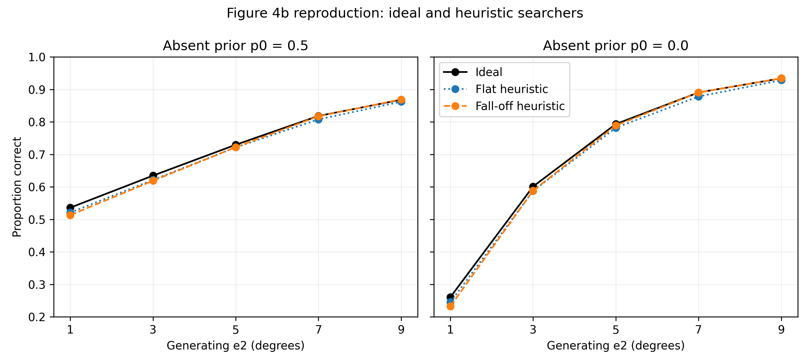

# Reproducing Figure 4b of Zhang & Geisler (2025)

A small Python reproduction of the simulation behind Figure 4b in
Zhang & Geisler (2025), *Optimal visual search with highly heuristic
decision rules*, Journal of Vision 25(4):5.

- Paper: <https://doi.org/10.1167/jov.25.4.5>
  ([open access on PMC](https://pmc.ncbi.nlm.nih.gov/articles/PMC12007678/))
- Authors' code: <https://github.com/anqi-j/supraoptimal-covert-search>

Figure 4b compares an ideal searcher with two simpler "heuristic"
searchers and shows that the heuristics perform close to the ideal.
This project re-implements that simulation from the paper and the
authors' notebooks. It is a learning exercise, not a new result.



## What the simulation does

A target is either absent or at one of 19 locations. On each trial,
every location produces one noisy number (a Gaussian response). If the
target is at a location, that response is shifted up by the location's
detectability d′. An observer looks at all 19 responses and reports
"absent" or the location it thinks has the target.

Detectability falls with eccentricity (distance from the center of
gaze). The **generating map** that produces the responses is
d′(e) = 6 · e2 / (e + e2), where e2 is the eccentricity at which d′
drops to half. Three observers judge the same responses:

- **Ideal**: uses the generating map.
- **Flat heuristic**: assumes d′ = 3.9 everywhere.
- **Fall-off heuristic**: assumes d′(e) = 6.9 · 7 / (e + 7).

The heuristic maps stay the same in every condition, and all three
observers use the correct prior. `model_notes.md` derives the decision
rule step by step.

## The 30 results

The sweep covers 2 absent priors (0 and 0.5) × 5 generating e2 values
(1, 3, 5, 7, 9) = 10 conditions, with 10,000 trials each. Each observer
gets one accuracy per condition, so `search_accuracy.csv` holds
10 × 3 = 30 accuracy estimates.

The figure has one panel per prior and three curves per panel (one per
observer), each plotted against e2: 6 curves with 5 points each. In
every condition the three accuracies are within 0.03 of each other, so
some curves overlap. For example, the ideal and fall-off curves nearly
coincide at e2 = 7 and 9. The paper draws both priors in one panel.

## Running the code

Tested on macOS with Python 3.14.7, NumPy 2.3.5, and Matplotlib 3.10.8.
From this folder:

```bash
python3 -m venv .venv
source .venv/bin/activate
python -m pip install -r requirements.txt
python simulate_search.py   # writes search_accuracy.csv
python test_model.py        # basic checks; run after the simulator
python make_figure.py       # writes figure4b_reproduction.png
```

The simulator uses a fixed seed (0), so rerunning it gives the same CSV.

## Files

| File | Purpose |
|---|---|
| `simulate_search.py` | Generates trials, applies the three decision rules, runs the 10 conditions |
| `make_figure.py` | Plots the CSV |
| `test_model.py` | Basic checks of the decision rule, indexing, and CSV |
| `model_notes.md` | Derivation of the model and decision rule |
| `search_accuracy.csv` | The 30 accuracy estimates (`true_e2` is the generating e2) |
| `figure4b_reproduction.png` | The generated figure |
| `requirements.txt` | Package versions |
| `LICENSE` | MIT license, including the original code's copyright notice |

## Sources and implementation choices

From the paper (and matching the notebooks):

- 19 locations, at most one target, absent prior 0 or 0.5, uniform over locations
- Independent Gaussian responses with standard deviation 1
- Generating map d′ = d′max · e2 / (e + e2) (Equation 6), with d′max = 6
  and e2 from 1° to 9°
- Decision rule: choose the largest of ln p_k + d′_k R′_k − 0.5 d′_k²
  (Equation 1). Equation 5 writes the same rule for a heuristic map in
  factored form, ln p̂ + d̂′ (R′ − 0.5 d̂′).
- A flat heuristic map, and a fall-off heuristic with d′max = 6.9 and
  e2 = 7 (Figure 4 text and Figure A4 caption)

From the notebooks only ([`simulation/Search Scan Ideal.ipynb`](https://github.com/anqi-j/supraoptimal-covert-search/blob/15a4a63bdbbb8a1ad2a813001c7505ab13d45964/simulation/Search%20Scan%20Ideal.ipynb) and
[`simulation/Search Scan Heuristic.ipynb`](https://github.com/anqi-j/supraoptimal-covert-search/blob/15a4a63bdbbb8a1ad2a813001c7505ab13d45964/simulation/Search%20Scan%20Heuristic.ipynb), commit
[`15a4a63bdbbb8a1ad2a813001c7505ab13d45964`](https://github.com/anqi-j/supraoptimal-covert-search/tree/15a4a63bdbbb8a1ad2a813001c7505ab13d45964)):

- Eccentricities 0°, 4° (×6), 6.9295° (×6), and 8° (×6)
- e2 values 1, 3, 5, 7, 9 and 10,000 trials per condition
- The flat value 3.9 (Figure 4a draws this line, and the fall-off map
  starting near 6.9, but gives neither number)

Choices made in this code:

- **Which notebook settings are Figure 4b.** The heuristic notebook runs
  every combination of peak (3.9, 6.9), fall-off (7, effectively
  infinite), and assumed absent prior (0, 0.5). This code uses flat 3.9,
  fall-off 6.9/7, and the correct prior. That matches the maps drawn in
  Figure 4a and the paper's text, but the source repository has no
  plotting code or saved Figure 4b values to confirm it.
- **Flat map.** The notebook writes the flat map as a fall-off with
  e2 = 10¹⁰. This code uses exactly 3.9; the two differ by less than 10⁻⁸.
- **How scores are computed.** The notebook scores the noise alone, adds
  (assumed d′ × true d′) to the target location's score, and divides the
  priors by p0. This code adds the true d′ to the response and then
  scores it. It is the same model written two ways; `test_model.py`
  checks that both give the same decisions.
- **Trials.** The notebooks run the ideal and heuristic observers in
  separate scripts with NumPy's global random generator. Here one
  generator (`default_rng(0)`) is used, and all three observers judge the
  same trials. This does not change expected accuracy, but the individual
  values differ from the paper's.
- **Plot.** Two panels instead of one, with colors by observer.

## Checks and limitations

- `test_model.py` checks that the prior sums to one, that zero d′ leaves
  only the prior, that all 20 states are indexed correctly, that the
  decisions match a full Gaussian likelihood calculation and the
  notebook's scoring, and that the CSV has each of the 30 combinations
  exactly once.
- Compared by eye, the curves cover the same range and shape as the
  published Figure 4b. The published points were not digitized, so this
  is not a numerical match. No parameters were tuned to match the plot.
- As a separate check (not included in this repository), the expected
  accuracy of all 30 cases was computed by numerical integration. Every
  simulated value was within 2.7 standard errors of it.
- Each accuracy has a standard error of at most 0.005. A heuristic can
  come out slightly above the ideal in one run without being better on
  average.
- Only Figure 4b is reproduced. The human data and the paper's other
  models and figures are not included.

## License

The original code is MIT-licensed, copyright Anqi Zhang, and that notice
is kept in `LICENSE`. The figure here was generated by this code; no
figure or text from the paper is included.
